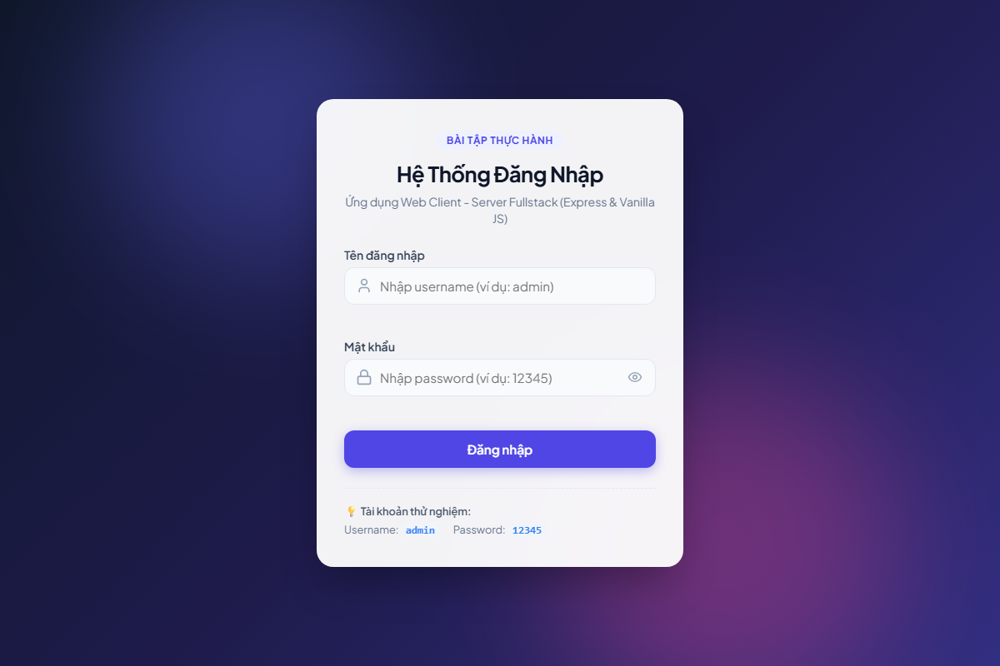
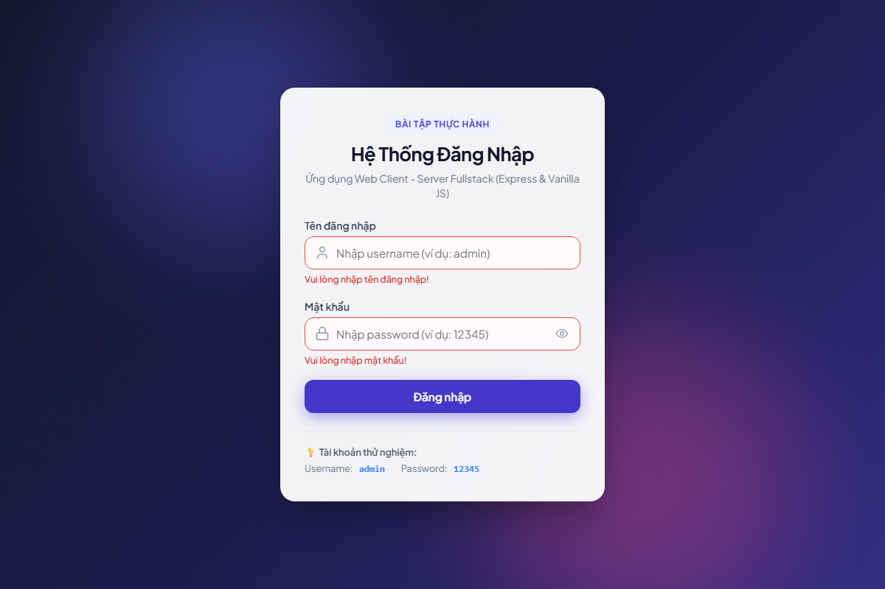
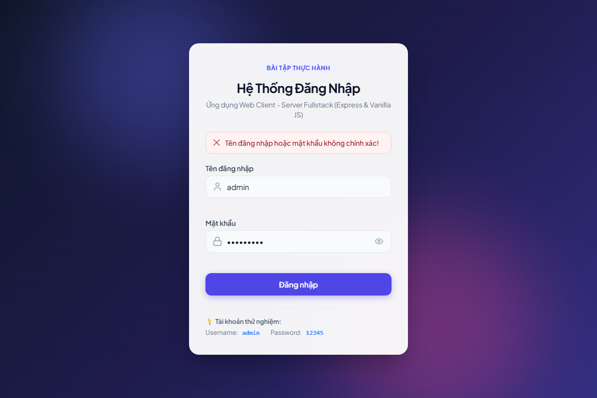
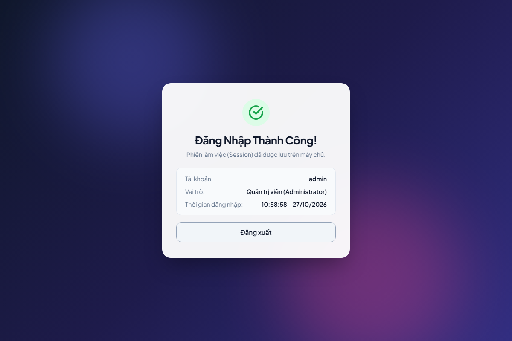

# BÁO CÁO BÀI TẬP THỰC HÀNH: XÂY DỰNG ỨNG DỤNG WEB FULLSTACK ĐƠN GIẢN

Dự án này là bài tập thực hành xây dựng ứng dụng Web Fullstack đơn giản gồm Frontend và Backend kết nối qua giao thức HTTP (AJAX/Fetch API), tích hợp kiểm tra dữ liệu, xác thực đăng nhập và quản lý phiên làm việc (Session/Cookie).

---

## 📁 Cấu trúc thư mục

```text
Bai 2/
├── public/                 # Mã nguồn Frontend
│   ├── css/
│   │   └── style.css       # Giao diện CSS hiện đại (Glassmorphism, Responsive)
│   ├── js/
│   │   └── app.js          # JavaScript xử lý AJAX Fetch, DOM, Validate
│   └── index.html          # Giao diện Form đăng nhập & Dashboard
├── screenshots/            # Ảnh chụp màn hình kết quả chạy demo
│   ├── 01_login_initial.png
│   ├── 02_validation_empty.png
│   ├── 03_login_failure.png
│   └── 04_login_success.png
├── server.js               # Backend Node.js Express server & REST API
├── package.json            # Thông tin dự án và dependencies
├── package-lock.json
└── README.md               # Hướng dẫn chạy và giải thích kiến trúc
```

---

## 🚀 Hướng dẫn cài đặt và khởi chạy

### 1. Yêu cầu môi trường
- Đã cài đặt [Node.js](https://nodejs.org/) (phiên bản 16 trở lên khuyến nghị).
- Trình duyệt Web hiện đại (Google Chrome, Microsoft Edge, Firefox,...).

### 2. Cài đặt các thư viện phụ thuộc
Mở terminal (PowerShell hoặc CMD) tại thư mục `Bai 2`:
```bash
npm install
```

### 3. Khởi động Server
```bash
npm start
```
*Ghi chú: Mặc định server chạy tại cổng `8080` (hoặc cổng được chỉ định qua biến môi trường `PORT`).*

### 4. Truy cập ứng dụng
Mở trình duyệt và truy cập:
```
http://localhost:8080
```

Tài khoản mặc định để kiểm tra:
- **Username:** `admin`
- **Password:** `12345`

---

## 🛠️ Các tính năng đã hoàn thiện

### 1. Frontend:
- **Form đăng nhập:** Thiết kế giao diện hiện đại theo phong cách Glassmorphism với gradient background, responsive trên cả máy tính và điện thoại.
- **Client Validation:** Kiểm tra rỗng ngay trên client trước khi gửi request, hiển thị lỗi trực quan bên dưới từng ô nhập liệu.
- **Trải nghiệm người dùng (UX):** Nút bật/tắt ẩn hiện mật khẩu, hiệu ứng loading spinner khi đang chờ phản hồi từ server.
- **Giao tiếp AJAX:** Sử dụng `fetch()` API để gửi dữ liệu dạng `application/json` qua phương thức `POST` và cập nhật thông báo thành công/thất bại ngay trên giao diện mà không tải lại trang (`e.preventDefault()`).

### 2. Backend (REST API):
- Xây dựng bằng **Node.js** và **Express**.
- **Server Validation:** Kiểm tra tính hợp lệ của dữ liệu đầu vào (loại bỏ khoảng trắng đầu/cuối, kiểm tra độ dài tối thiểu).
- **Xác thực:** Kiểm tra tài khoản `admin` / `12345`:
  - Nếu đúng: Trả về HTTP `200 OK` kèm thông tin người dùng và khởi tạo Session.
  - Nếu sai: Trả về HTTP `401 Unauthorized` hoặc `400 Bad Request` kèm thông báo lỗi cụ thể.
- **Quản lý phiên (Session & Cookie):**
  - Sử dụng `express-session` lưu trạng thái đăng nhập phía server và set cookie `connect.sid` mã hóa (HttpOnly) xuống client.
  - API `GET /api/me`: Kiểm tra phiên đăng nhập hiện tại khi người dùng tải lại trang.
  - API `POST /api/logout`: Hủy session phía server và xóa cookie client.

---

## 📡 Danh sách API Backend

| Phương thức | Đường dẫn | Chức năng | Dữ liệu gửi (Body) | Mã phản hồi |
|---|---|---|---|---|
| `POST` | `/api/login` | Xác thực đăng nhập | `{"username": "...", "password": "..."}` | 200 / 400 / 401 |
| `GET` | `/api/me` | Lấy thông tin phiên hiện tại | Không | 200 / 401 |
| `POST` | `/api/logout` | Đăng xuất người dùng | Không | 200 |

---

## 🏛️ Ghi chú: Kiến trúc Client - Server trong ứng dụng

1. **Mô hình tổng thể:**
   - **Client (Frontend):** Chạy trên trình duyệt người dùng, chịu trách nhiệm render HTML/CSS, lắng nghe tương tác người dùng, kiểm tra sơ bộ dữ liệu (Client-side validation) và gửi các HTTP Request bất đồng bộ.
   - **Server (Backend):** Lắng nghe tại cổng mạng (Port 8080), tiếp nhận HTTP Request, xử lý logic xác thực, quản lý phiên làm việc và gửi về HTTP Response dưới định dạng JSON.

2. **Luồng trao đổi dữ liệu (AJAX Request/Response Cycle):**
   ```text
   [Client Browser] 
          |  (1) POST /api/login { username, password }
          v
   [Express Server] ---> Kiểm tra dữ liệu & thông tin đăng nhập
          |
          |  (2) Thành công: Tạo Session + Set-Cookie
          |      Thất bại: Mã lỗi HTTP 401/400
          v
   [Client Browser] <--- Nhận JSON phản hồi, cập nhật DOM không reload trang
   ```

3. **Bảo mật và Session:**
   - Việc chỉ kiểm tra trên Frontend là chưa đủ vì người dùng có thể can thiệp hoặc gửi request trực tiếp bằng Postman/cURL. Do đó, Backend luôn thực hiện validate độc lập.
   - Session giúp ứng dụng nhận diện được người dùng qua nhiều request khác nhau thông qua Session ID lưu trong HTTP-only Cookie.

---

## 📸 Ảnh chụp màn hình minh chứng kết quả (Screenshots)

### 1. Giao diện ban đầu


### 2. Kiểm tra dữ liệu nhập (Validation rỗng)


### 3. Đăng nhập thất bại (Sai tài khoản / mật khẩu)


### 4. Đăng nhập thành công và Dashboard phiên làm việc

