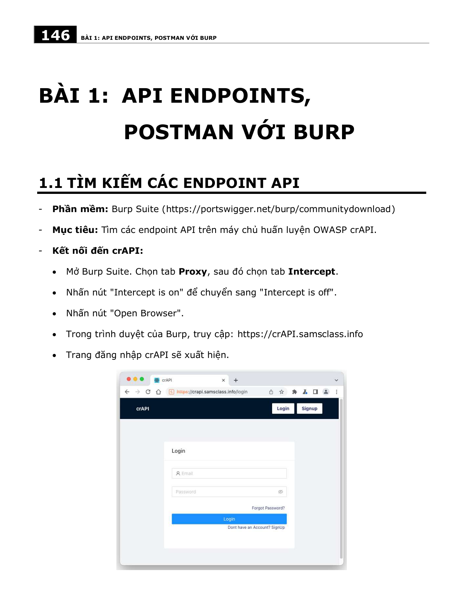
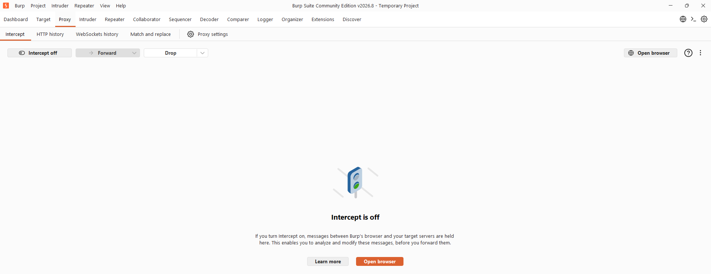

# Báo Cáo & Thuyết Trình Cuối Kỳ - An Toàn Web & CSDL

* **Sinh viên thực hiện:** Trần Tăng Trường Thịnh
* **MSSV:** 2387701939
* **Môn học:** An Toàn Web & Cơ Sở Dữ Liệu

---

## 📌 Chức năng & Nội dung chính
1. **Phân tích bề mặt tấn công Web & CSDL:** Đánh giá các nguy cơ an ninh phổ biến (SQLi, NoSQLi, Broken Authentication, IDOR, XSS).
2. **Kỹ thuật phòng thủ đa lớp:** Áp dụng Prepared Statements, ORM hardening, Content Security Policy (CSP), mã hóa dữ liệu nhạy cảm lưu trữ (AES-256) và truyền tải (TLS 1.3).
3. **Slide thuyết trình & Báo cáo tổng kết:** Tổng hợp toàn diện kết quả thực nghiệm an ninh thông tin.

---

## 🖼️ Hình Ảnh Giao Diện & Báo Cáo

*Slide báo cáo thuyết trình an toàn ứng dụng Web & Cơ sở dữ liệu*

*Minh họa đánh giá lỗ hổng và giải pháp khắc phục an toàn dữ liệu*