# 🛡️ Hệ Thống Thương Mại Điện Tử & Phòng Chống Gian Lận Thanh Toán Trực Tuyến

> **Đồ Án Môn Học / Tốt Nghiệp: An Toàn Web & Cơ Sở Dữ Liệu**  
> **Đường dẫn thư mục dự án:** `C:\Users\Admin\Documents\Web_basic\DoAnANW`  
> **Kiến trúc:** Python FastAPI (Backend) + HTML5/CSS3/Vanilla JS (Frontend) + SQLite  
> **Tích hợp:** Rule-based Engine (13 luật độc lập) + Composite Pattern Engine + Thuật toán tính điểm suy giảm biên độ + Cơ chế xác thực nâng cao Smart OTP 2FA.

---

## 📌 1. Giới Thiệu Tổng Quan

Dự án xây dựng một nền tảng **Website Thương mại Điện tử hoàn chỉnh** tích hợp **Hệ thống Phát hiện và Ngăn chặn Gian lận Thanh toán (Payment Fraud Detection & Prevention System)** thời gian thực theo chuẩn kiến trúc micro-engine.

Mọi giao dịch checkout thẻ quốc tế (Visa/Mastercard/JCB) đều trải qua chu trình trích xuất đặc trưng thời gian thực trong cửa sổ trượt (sliding window), đánh giá song song qua 13 luật phòng chống gian lận, đối chiếu mẫu hình tấn công phức hợp và chấm điểm rủi ro tường minh (thang điểm 0 - 100) để ra phán quyết tự động:
- **`APPROVE`** (0 <= Score < 50): Chấp thuận giao dịch an toàn, chuyển tiếp trừ tiền tại cổng thanh toán.
- **`REVIEW`** (50 <= Score < 80): Tạm giữ giao dịch diện nghi vấn, kích hoạt thử thách xác thực **Smart OTP 2FA** qua SMS.
- **`BLOCK`** (80 <= Score <= 100): Chặn giao dịch tức thì tại cổng API, từ chối kết nối sang ngân hàng và khóa tạm thời tài khoản.

---

## 🏗️ 2. Ngăn Xếp Công Nghệ & Kiến Trúc Kỹ Thuật

- **Backend**: Python 3.11, FastAPI (Asynchronous Framework), Pydantic v2 (Validation & Schemas), Uvicorn (ASGI Server), Python-JOSE (JWT Authentication), Passlib/Bcrypt (Băm mật khẩu an toàn).
- **Frontend**: Single Page Application (SPA), HTML5, CSS3 hiện đại, Tailwind CSS, Lucide Icons, Vanilla JavaScript dạng component-based, tích hợp sẵn thanh điều khiển giả lập (HUD Simulator).
- **Cơ sở dữ liệu**: SQLite3 (`fraud_ecommerce.db`) với các bảng: `users`, `products`, `orders`, `transactions`, `rules_config`, `fraud_signals`, `sms_notifications`.
- **Hiệu năng kiểm chuẩn**: Độ trễ thuật toán Fraud Engine in-memory trung bình **0.093 ms** (P95 đạt 0.104 ms), độ trễ toàn trình HTTP API trung bình **14.2 ms** (đáp ứng tiêu chuẩn thời gian thực < 150 ms của cổng thanh toán).

---

## 🧮 3. Cơ Chế Tính Điểm Rủi Ro (Score Calculation Model)

Hệ thống loại bỏ cơ chế cộng dồn tuyến tính để chống hiện tượng bùng nổ điểm số giả (*Score Saturation*), thay vào đó áp dụng mô hình toán học trọng số suy giảm biên độ:

```text
Combined_Score = round( S_max + 0.5 * (S_rules - S_max) + 0.7 * S_patterns )
Risk_Score = min( 100, max( 0, Combined_Score ) )
```

- **S_max**: Điểm của luật có độ nghiêm trọng cao nhất trong các luật bị kích hoạt (chiếm 100% tỷ trọng đóng góp).
- **S_rules - S_max**: Tổng điểm của các luật vi phạm phụ còn lại (hưởng trọng số suy giảm 50%).
- **S_patterns**: Điểm đóng góp từ các mẫu hình tấn công phức hợp kích hoạt từ `SuspiciousPatternRule` (hưởng trọng số 70%).

---

## 🖥️ 4. Chi Tiết Giao Diện Hệ Thống (UI Breakdown)

Hệ thống được thiết kế với 14 màn hình giao diện trực quan, chia thành 2 phân khu nghiệp vụ hoàn chỉnh:

### Phần I: Giao diện Phía Khách hàng (Storefront & Customer Journey)

| STT | Giao Diện Minh Họa | Mô Tả Kỹ Thuật & Nghiệp Vụ |
| :---: | :--- | :--- |
| **3.1** | **Trang chủ & Danh mục sản phẩm công nghệ**<br><br> | Trình bày danh mục thiết bị công nghệ hiện đại (Laptop cao cấp, Flagship smartphone, Tai nghe), lọc theo danh mục, hiển thị giỏ hàng trực tuyến và banner chương trình khuyến mãi. |
| **3.2** | **Xác thực Đăng nhập & Tài khoản Demo**<br><br>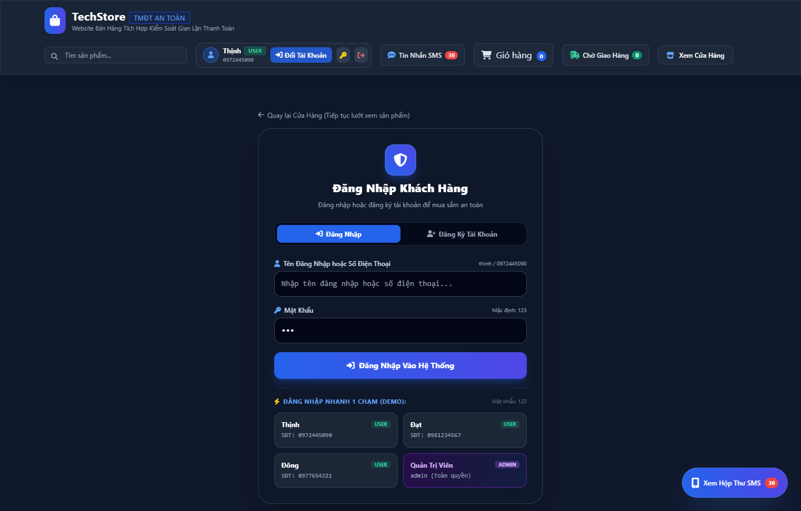 | Đăng nhập/đăng ký tài khoản an toàn với token JWT. Tích hợp thanh chọn tài khoản demo (Khách hàng thông thường, Quản trị viên, Tài khoản bị theo dõi) phục vụ kiểm thử nhanh. |
| **3.3** | **Giỏ hàng trực tuyến (Shopping Cart Modal)**<br><br> | Modal giỏ hàng dạng trượt, quản lý danh sách sản phẩm đã chọn, tăng giảm số lượng tức thì, tự động tính tổng tiền và chuyển tiếp đến màn hình Checkout. |
| **3.4** | **Thanh toán Checkout & Giả lập Kịch bản**<br><br>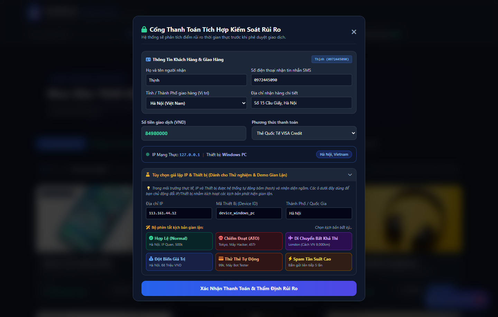 | Nhập thông tin giao hàng (chuẩn hóa Geo-IP) và thẻ quốc tế theo chuẩn che mờ PCI-DSS. Tích hợp thanh **Attack Simulation Presets** (Legit, ATO Attack, Impossible Travel, Velocity Attack, Card Testing). |
| **3.5** | **Kết quả Chặn Thanh toán Rủi ro Cao**<br><br>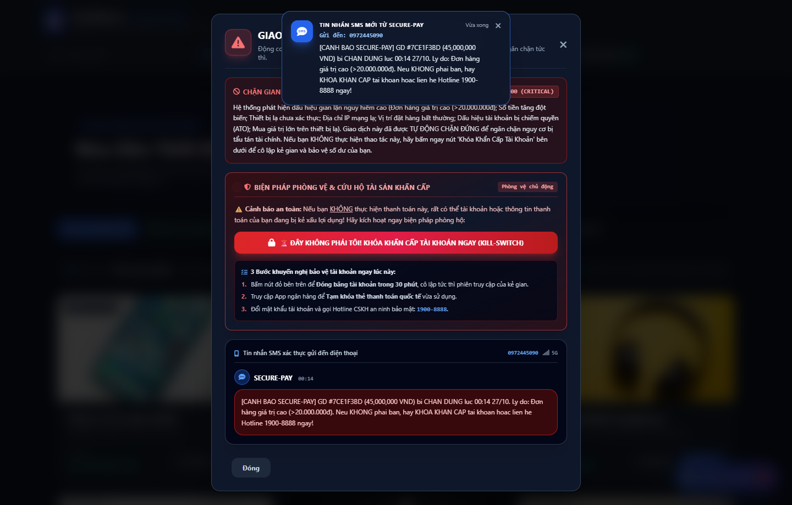 | Hiển thị khi Risk Score chạm ngưỡng >= 80 (CRITICAL). Giao diện khiên đỏ báo động khẩn cấp, đồng hồ điểm 100/100, liệt kê chi tiết các hành vi vi phạm và thông báo tạm khóa tài khoản. |
| **3.6** | **Thử thách Xác thực Smart OTP 2FA**<br><br>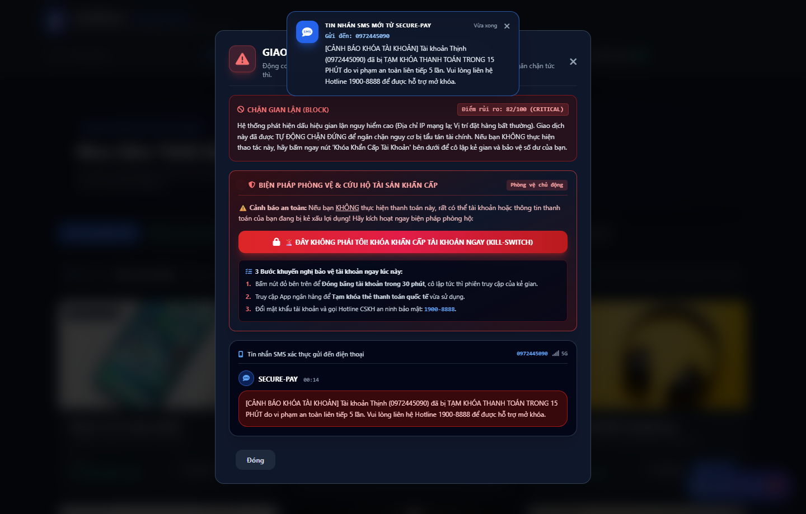 | Cơ chế Step-up 2FA kích hoạt khi giao dịch rơi vào diện nghi vấn (50 <= Score < 80 - HIGH, ví dụ Impossible Travel). Yêu cầu khách hàng nhập mã OTP 6 số để hoàn tất đơn hàng. |
| **3.7** | **Hộp thư SMS ảo (Virtual SMS Modal)**<br><br>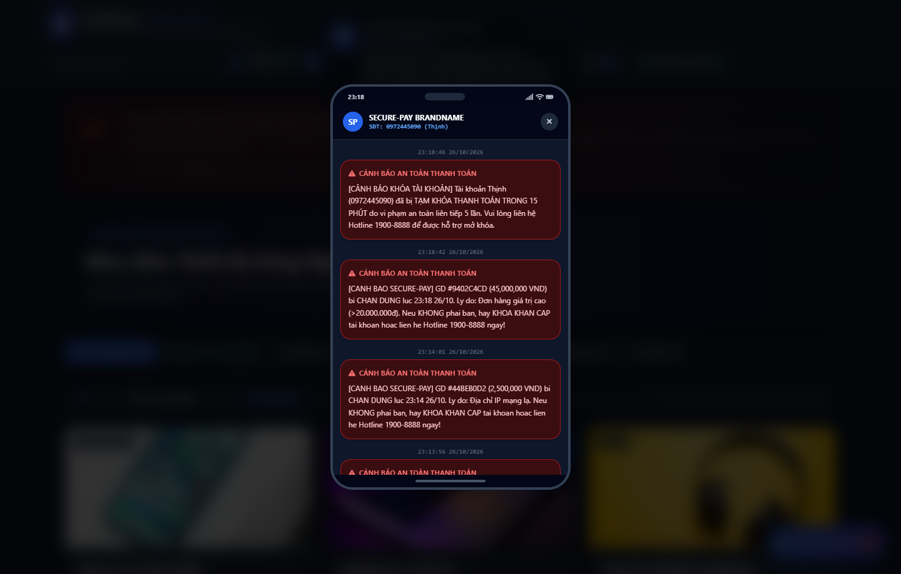 | Giả lập ứng dụng tin nhắn điện thoại của chủ thẻ: Tiếp nhận mã Smart OTP xác thực hai yếu tố và các tin nhắn cảnh báo bảo mật khi có đăng nhập từ thiết bị lạ. |
| **3.8** | **Lịch sử Đơn hàng (Orders History)**<br><br>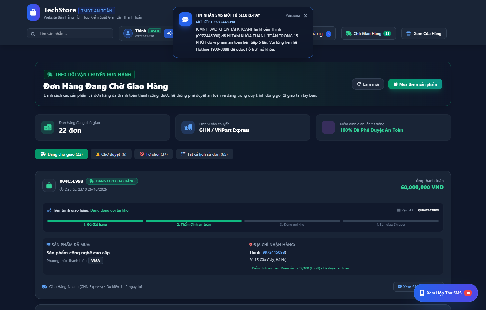 | Cho phép khách hàng tra cứu chi tiết toàn bộ các đơn hàng đã thực hiện, kèm trạng thái xử lý tương ứng (`completed`, `review_required`, `blocked`) và dấu thời gian. |

---

### Phần II: Giao diện Quản trị & Điều tra Pháp chứng (Admin Center)

| STT | Giao Diện Minh Họa | Mô Tả Kỹ Thuật & Nghiệp Vụ |
| :---: | :--- | :--- |
| **3.9** | **Tổng quan Quản trị & KPI Analytics**<br><br>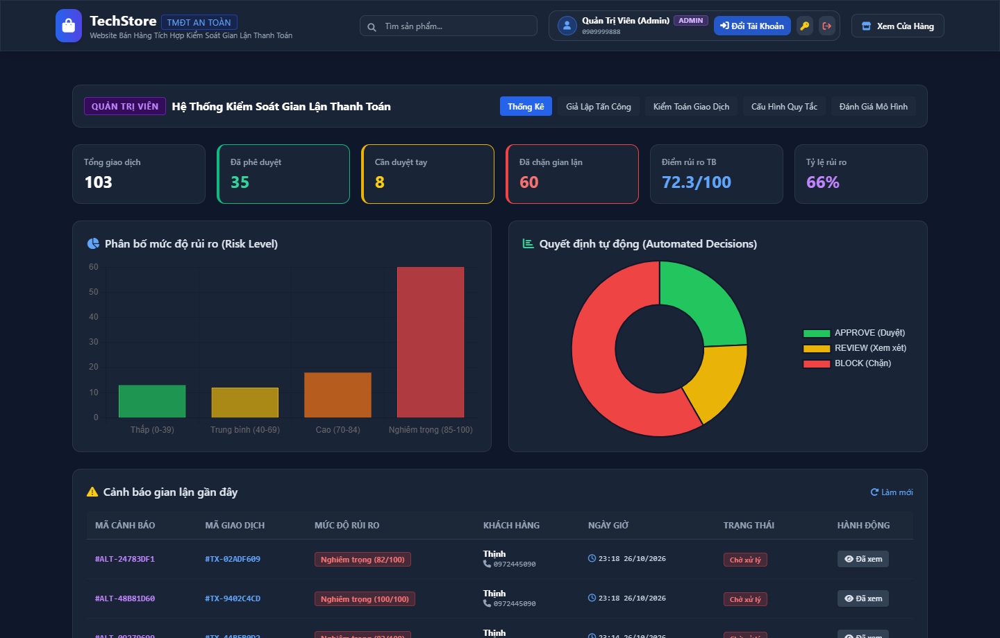 | Bảng điều khiển trung tâm hiển thị các chỉ số KPI theo thời gian thực: Tổng doanh thu an toàn, Tỷ lệ giao dịch chặn (Block Rate), Tỷ lệ xem xét (Review Rate) và biểu đồ xu hướng rủi ro. |
| **3.10** | **Bảng Điều tra Pháp chứng Giao dịch**<br><br>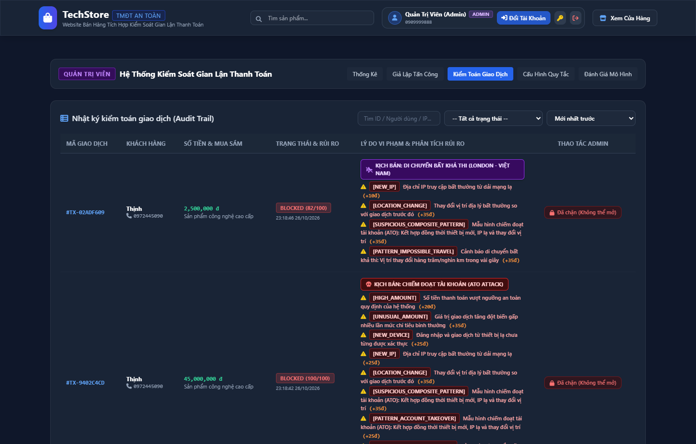 | Danh sách giao dịch chi tiết phục vụ điều tra: Mã TX, Người dùng, Điểm Risk Score, Cấp độ rủi ro, Phán quyết, Danh sách luật bị kích hoạt và các nút can thiệp thủ công (Duyệt/Chặn). |
| **3.11** | **Giả lập Tấn công Chiếm đoạt Tài khoản (ATO)**<br><br>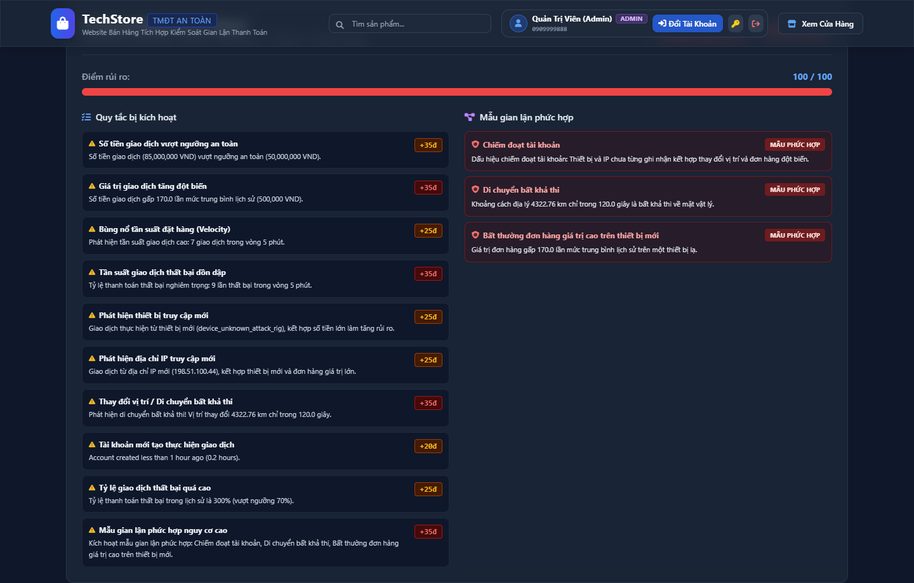 | Giả lập tấn công Account Takeover: Đăng nhập từ thiết bị Kali Linux lạ, địa chỉ IP Tor/VPN, mật khẩu vừa bị thay đổi và phát sinh đơn hàng giá trị lớn (45.000.000 VNĐ). |
| **3.12** | **Giả lập Di chuyển Bất khả thi (Impossible Travel)**<br><br>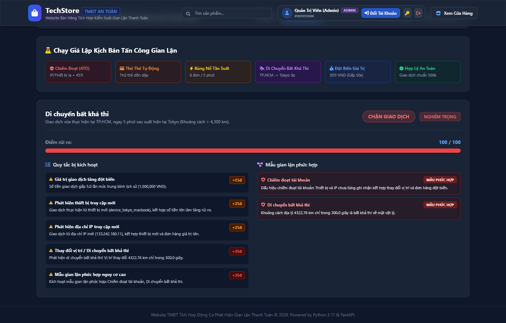 | Ứng dụng công thức Haversine đo khoảng cách đại vòng tròn: Phát hiện giao dịch phát sinh tại London sau 10 phút kể từ giao dịch tại Hà Nội (khoảng cách 9.214,5 km, vận tốc suy luận 55.176 km/h). |
| **3.13** | **Quản lý & Cấu hình Tham số Bộ Luật**<br><br>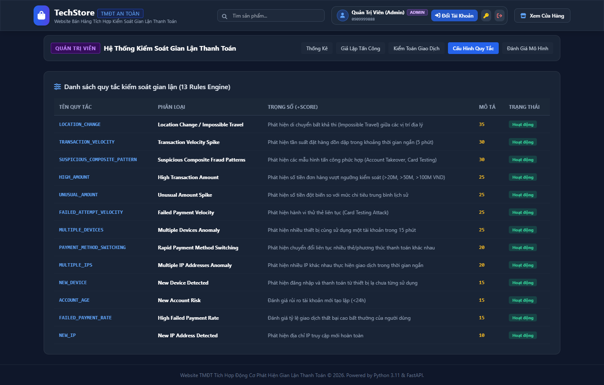 | Cho phép quản trị viên bật/tắt động 13 luật phòng chống gian lận, điều chỉnh trọng số điểm số (Weight) và thay đổi các ngưỡng kích hoạt mà không cần khởi động lại máy chủ. |
| **3.14** | **Đánh giá Hiệu năng & Ma trận Nhầm lẫn**<br><br>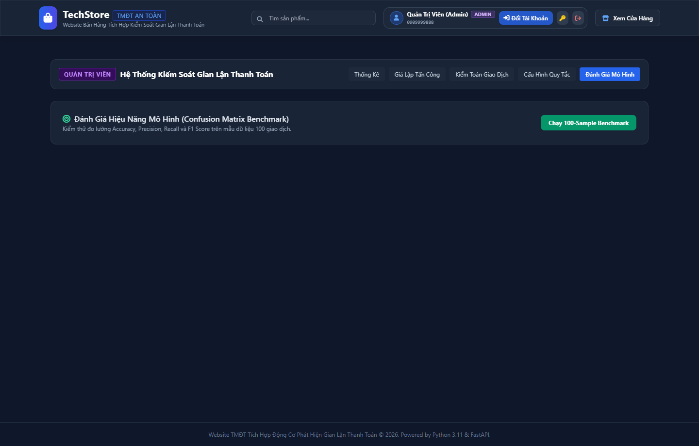 | Công cụ kiểm chuẩn tự động: Chạy bộ kiểm thử phân loại nhị phân trên 200 mẫu, trực quan hóa Ma trận nhầm lẫn (Confusion Matrix), đo lường Accuracy (97%), Precision (96.08%), Recall (98%) và F1-Score (97.03%). |

---

## 🚀 5. Hướng Dẫn Cài Đặt & Khởi Chạy

### Yêu cầu môi trường
- Python 3.10+ hoặc 3.11+
- Hệ điều hành: Windows, macOS hoặc Linux

### Các bước thực hiện

1. **Mở cửa sổ dòng lệnh tại thư mục dự án:**
   ```bash
   cd C:\Users\Admin\Documents\Web_basic\DoAnANW
   ```

2. **Cài đặt các thư viện cần thiết:**
   ```bash
   pip install fastapi uvicorn pydantic python-jose passlib bcrypt requests pytest numpy
   ```

3. **Khởi tạo cơ sở dữ liệu mẫu ban đầu (Seed Data):**
   ```bash
   python python_app/seed.py
   ```

4. **Khởi chạy máy chủ FastAPI Backend:**
   ```bash
   python python_app/main.py
   ```
   *Máy chủ sẽ lắng nghe tại:* `http://localhost:8000`

5. **Trải nghiệm ứng dụng trên trình duyệt web:**
   - **Giao diện Cửa hàng TMĐT & Thanh toán:** [http://localhost:8000](http://localhost:8000)
   - **Tài liệu API Swagger UI tương tác:** [http://localhost:8000/docs](http://localhost:8000/docs)
   - **Chuyển đổi giao diện:** Bấm nút chuyển đổi **Khách hàng / Quản trị viên** trên thanh Menu góc phải trên cùng.

---

## 🧪 6. Chạy Kiểm Thử Độc Lập

- **Đo lường độ trễ và kiểm chuẩn 500 mẫu giao dịch:**
  ```bash
  python -c "import time, numpy as np; from python_app.fraud.simulation_engine import build_scenario_context; from python_app.fraud.fraud_engine import fraud_engine; times = []; [times.append((time.perf_counter(), fraud_engine.analyze_transaction(build_scenario_context(s)['context']), time.perf_counter())) for s in ['NORMAL', 'CARD_TESTING', 'IMPOSSIBLE_TRAVEL', 'ACCOUNT_TAKEOVER']*125]; lats = [(t[2]-t[0])*1000 for t in times]; print(f'Mean: {np.mean(lats):.3f}ms | P50: {np.percentile(lats, 50):.3f}ms | P95: {np.percentile(lats, 95):.3f}ms | P99: {np.percentile(lats, 99):.3f}ms | Max: {max(lats):.3f}ms')"
  ```

- **Chạy toàn bộ unit test:**
  ```bash
  pytest python_app/tests
  ```

---
*Tài liệu README được cập nhật chuẩn hóa cho Đồ án An Toàn Web & Cơ Sở Dữ Liệu.*
