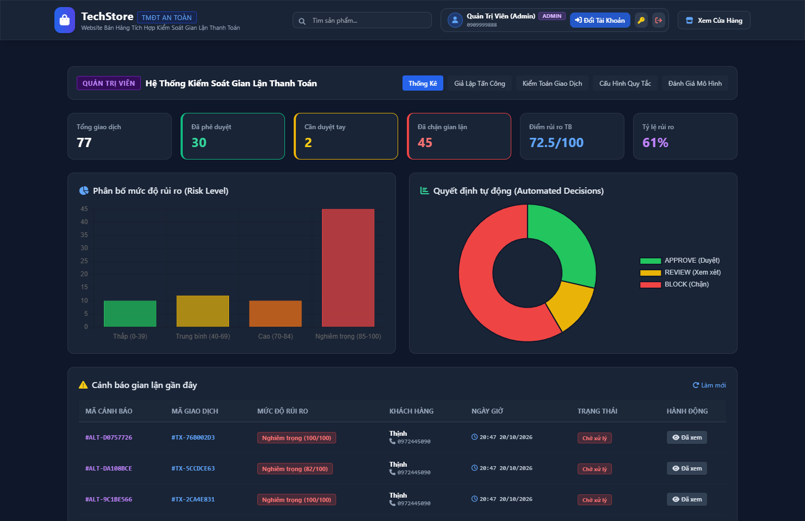

# Học Phần: An Toàn Web & Cơ Sở Dữ Liệu (ATW&CSDL)

Thư mục lưu trữ toàn bộ các bài tập thực hành, bài tập lớn và đồ án học phần **An Toàn Web & Cơ Sở Dữ Liệu** tại Trường Đại học Công nghệ TP.HCM (HUTECH).

* **Sinh viên:** Trần Tăng Trường Thịnh
* **MSSV:** 2387701939
* **Lớp:** 23DATA1

---

## 📂 Danh Sách Bài Thực Hành & Đề Tài

| Thư mục | Tên bài / Đề tài | Nội dung & Chức năng chính |
| :--- | :--- | :--- |
| [📁 Bai 1](./Bai%201) | Phân tích HTTP & Kiến trúc Web | Phân tích gói tin HTTP/HTTPS, DevTools Network Waterfall, kiến trúc 3 lớp (3-tier) |
| [📁 Bai 2](./Bai%202) | Bảo mật Session & Form Đăng nhập | Triển khai Node.js/Express, Cookie Session an toàn, bảo vệ chống brute-force |
| [📁 Bai 9](./Bai%209) | Khai thác Lỗ hổng Web OWASP Top 10 | Tấn công & phòng chống SQL Injection, Stored/Reflected XSS, IDOR, Header Injection |
| [📁 Cuoi Ki](./Cuoi%20Ki) | Báo cáo & Thuyết trình Cuối kỳ | Đánh giá an ninh hệ thống cơ sở dữ liệu và giải pháp phòng thủ ứng dụng Web |
| [📁 DoAnANW](./DoAnANW) | Đồ án: Hệ thống Phát hiện Gian lận | E-commerce phát hiện giao dịch gian lận bằng Rule Engine + ML Scoring |

---

## 🖼️ Hình Ảnh Minh Họa Giao Diện

*Sơ đồ phân tích luồng dữ liệu kiến trúc 3 lớp và an toàn giao tiếp Web*

*Giao diện Admin Dashboard giám sát giao dịch và phát hiện gian lận trong đồ án môn học*