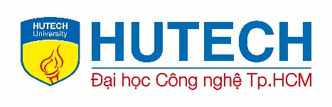
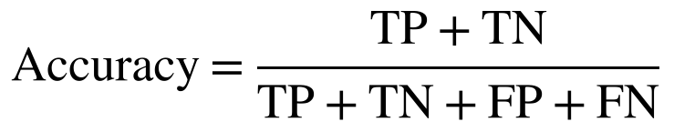

# Đề Cương Đồ Án Chuyên Ngành: Tích Hợp AI Vào SIEM Phát Hiện Đe Dọa EDR

* **Sinh viên thực hiện:** Trần Tăng Trường Thịnh
* **MSSV:** 2387701939
* **Chuyên ngành:** An toàn Thông tin - HUTECH

---

## 📌 Mục Tiêu & Chức Năng Đề Tài
1. **Thu thập Log EDR & Sysmon:** Tích hợp log sự kiện từ máy trạm và máy chủ vào hệ thống SIEM tập trung.
2. **Ứng dụng Machine Learning:** Phân tích hành vi bất thường (UEBA), phát hiện kỹ thuật tấn công APT theo ma trận MITRE ATT&CK.
3. **Tự động hóa phản ứng (SOAR):** Cách ly máy chủ bị nhiễm, chặn địa chỉ IP độc hại và kích hoạt cảnh báo theo thời gian thực.

---

## 🖼️ Hình Ảnh Minh Họa Kiến Trúc

*Sơ đồ luồng phân tích dữ liệu log và kiến trúc tích hợp mô hình AI vào SIEM*

*Mô hình hóa chuỗi tấn công và phát hiện bất thường từ EDR telemetry*