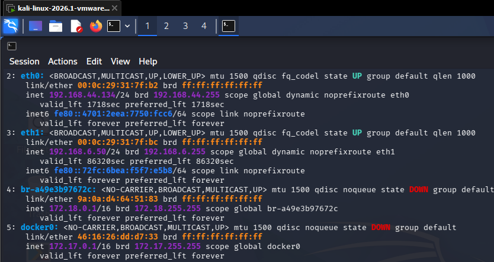
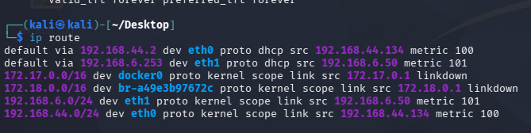

# Lab 3: Mô Hình Hóa Mối Đe Dọa & Khai Thác Lỗ Hổng SMB MS17-010

* **Học phần:** Lập trình An toàn Thông tin
* **Sinh viên:** Trần Tăng Trường Thịnh - 2387701939
* **Môi trường thực hành:** Kali Linux, Windows Target, Nmap, Metasploit Framework.

---

## 📌 Chức Năng Chính
1. **Thu thập thông tin & Quét lỗ hổng:** Sử dụng Nmap NSE script (`smb-vuln-ms17-010`) dò tìm máy chủ Windows mở cổng 445 chưa vá lỗi EternalBlue.
2. **Khai thác lỗ hổng bằng Metasploit:** Cấu hình module `exploit/windows/smb/ms17_010_eternalblue`, mở phiên tương tác Meterpreter session.
3. **Hậu khai thác & Phòng thủ:** Thu thập thông tin hệ thống, đề xuất giải pháp vô hiệu hóa SMBv1 và cập nhật bản vá bảo mật Microsoft MS17-010.

---

## 🖼️ Hình Ảnh Quá Trình Thực Nghiệm

*Kết quả quét Nmap NSE xác định máy mục tiêu dính lỗ hổng MS17-010*

*Giao diện dòng lệnh Meterpreter chiếm quyền điều khiển hệ thống thành công*