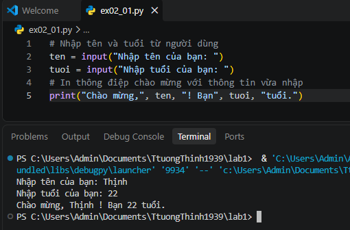
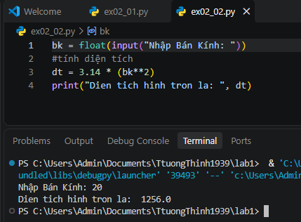

# Lab 1: Nhập Môn Lập Trình An Toàn Thông Tin & Mã Hóa Thay Thế

* **Học phần:** Lập trình An toàn Thông tin
* **Sinh viên:** Trần Tăng Trường Thịnh - 2387701939

---

## 📌 Chức Năng Chính
1. **Lập trình Python cơ bản:** Xử lý chuỗi, cấu trúc dữ liệu, đọc ghi tệp an toàn.
2. **Triển khai mật mã cổ điển:**
   * Mật mã Caesar (Dịch chuyển bảng chữ cái)
   * Mật mã Vigenère (Bảng tra khóa khóa ký tự)
   * Mật mã thay thế đơn bảng (Substitution Cipher)
3. **Phân tích tần suất:** Kỹ thuật thám mã tần suất ký tự tiếng Anh nhằm giải mã bản mã Caesar không cần biết trước khóa.

---

## 🖼️ Hình Ảnh Kết Quả Thực Nghiệm

*Kết quả thực thi thuật toán mã hóa và giải mã chuỗi ký tự bằng Python*

*Giao diện kết quả phân tích tần suất ký tự và bẻ khóa văn bản mã hóa*