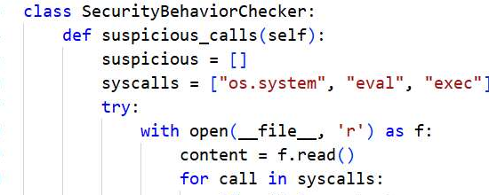
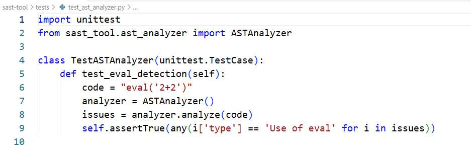

# Lab 5: Tấn Công & Phòng Thủ Ứng Dụng Web Nâng Cao

* **Học phần:** Lập trình An toàn Thông tin
* **Sinh viên:** Trần Tăng Trường Thịnh - 2387701939

---

## 📌 Chức Năng Chính
1. **Bắt và sửa đổi gói tin:** Sử dụng Burp Suite Proxy phân tích các tham số truyền qua HTTP Request.
2. **Khai thác các lỗ hổng Web nghiêm trọng:**
   * SQL Injection dạng Union-based và Error-based
   * Cross-Site Scripting (XSS Stored & Reflected)
   * Insecure Direct Object References (IDOR)
3. **Đề xuất kỹ thuật phòng ngự:** Sử dụng Parameterized Queries, Output Encoding, bộ lọc đầu vào và cơ chế kiểm soát truy cập (Access Control).

---

## 🖼️ Hình Ảnh Thực Nghiệm

*Minh họa phân tích và kiểm thử an ninh ứng dụng web*

*Bắt gói tin HTTP Request qua Burp Suite Proxy để phân tích dữ liệu*