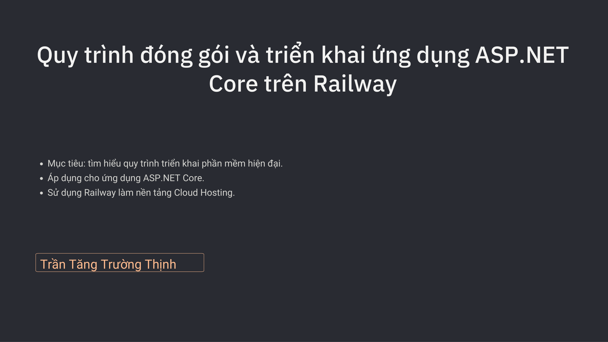
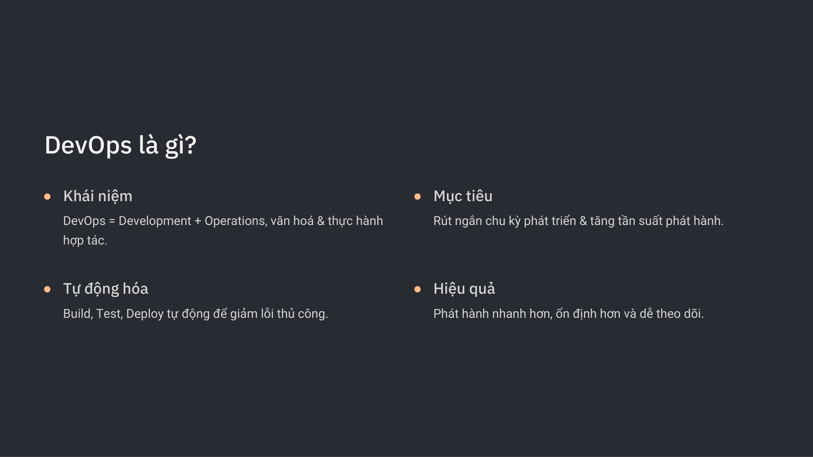

# Chuyên Đề Thuyết Trình: Triển Khai ASP.NET Core Lên Railway Cloud

* **Sinh viên:** Trần Tăng Trường Thịnh - 2387701939
* **Nội dung:** Hướng dẫn CI/CD và triển khai ứng dụng ASP.NET Core kết nối cơ sở dữ liệu lên nền tảng Railway Cloud.

---

## 📌 Các Bước & Chức Năng Triển Khai
1. **Chuẩn bị dự án:** Cấu hình Dockerfile hoặc Nixpacks, thiết lập cổng `PORT` từ biến môi trường của Railway.
2. **Cấu hình Database Cloud:** Khởi tạo PostgreSQL / MySQL trên Railway và cập nhật `ConnectionStrings`.
3. **Tự động hóa CI/CD:** Liên kết GitHub Repository với Railway, tự động build & deploy sau mỗi lệnh `git push`.

---

## 🖼️ Hình Ảnh Minh Họa Thuyết Trình

*Trang bìa slide chuyên đề thuyết trình Deploy ASP.NET Core lên Railway*

*Sơ đồ kiến trúc liên kết GitHub repository và Railway Cloud container*