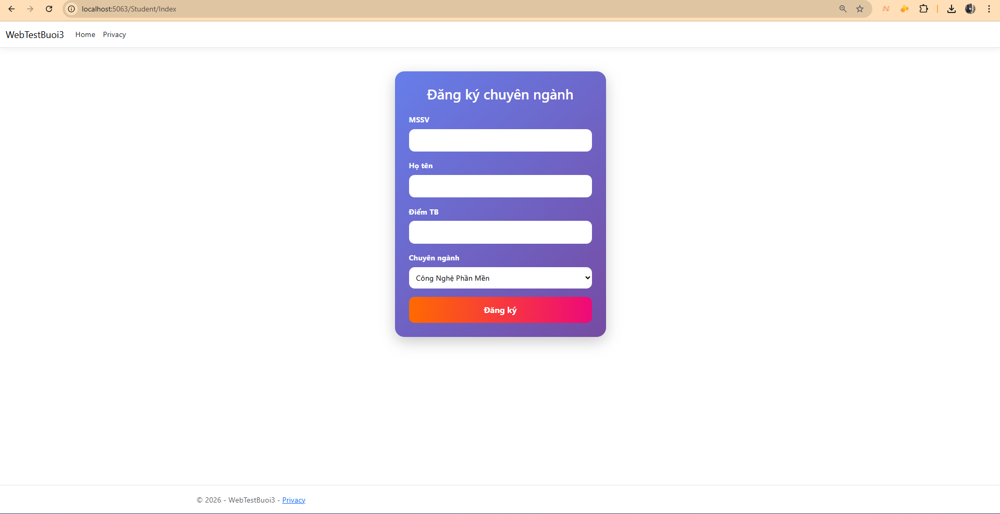
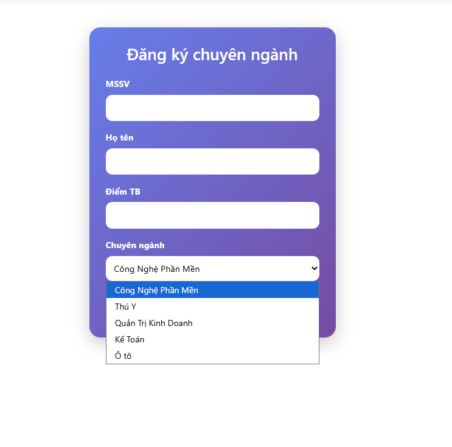

# Buổi 3 (08/05): Làm Quen Kiến Trúc ASP.NET Core MVC & Controller

* **Học phần:** Lập trình Web
* **Sinh viên:** Trần Tăng Trường Thịnh - 2387701939

---

## 📌 Chức Năng Chính
1. **Routing & Controllers:** Tìm hiểu cơ chế định tuyến Controller/Action trong ASP.NET Core.
2. **Quản lý danh sách sinh viên (`StudentController`):** Hiển thị danh sách, truyền dữ liệu từ Controller sang View qua ViewModel.
3. **Bài tập sản phẩm (`HomeController`):** Trình bày card sản phẩm linh hoạt với Grid System.

---

## 🖼️ Hình Ảnh Giao Diện Thực Hành

*Giao diện danh sách sinh viên hiển thị theo cấu trúc bảng Bootstrap*

*Giao diện chi tiết thông tin sinh viên và điều hướng thao tác*