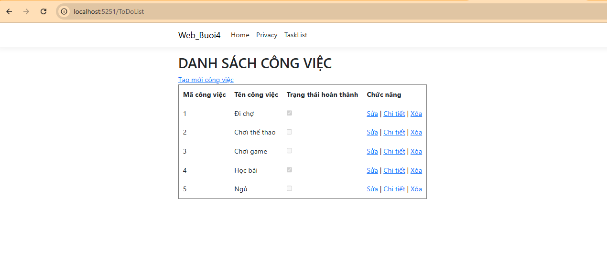
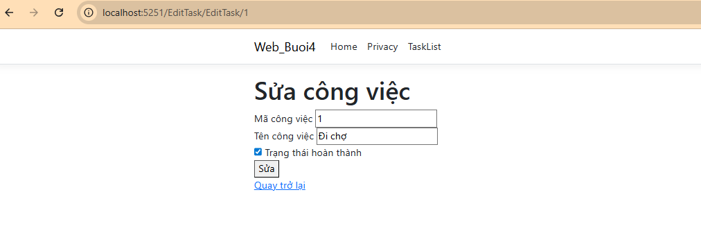

# Buổi 4 (15/05): Ứng Dụng Quản Lý Công Việc (Task Management CRUD)

* **Học phần:** Lập trình Web (ASP.NET Core MVC)
* **Sinh viên:** Trần Tăng Trường Thịnh - 2387701939

---

## 📌 Chức Năng Chính
1. **Mô hình dữ liệu Task:** Khai báo thuộc tính Title, Description, DueDate, IsCompleted và Data Annotations.
2. **Bộ thao tác CRUD hoàn chỉnh:**
   * Xem danh sách công việc (`Index`)
   * Thêm mới công việc (`Create`)
   * Chỉnh sửa thông tin công việc (`Edit`)
   * Xóa công việc với xác nhận (`Delete`)
   * Xem chi tiết (`Details`)
3. **Validation dữ liệu:** Kiểm tra tính hợp lệ dữ liệu ngay tại Client và Server.

---

## 🖼️ Hình Ảnh Giao Diện Thực Hành

*Giao diện quản lý danh sách công việc cần làm*

*Form tạo công việc mới với kiểm tra ràng buộc dữ liệu trực quan*