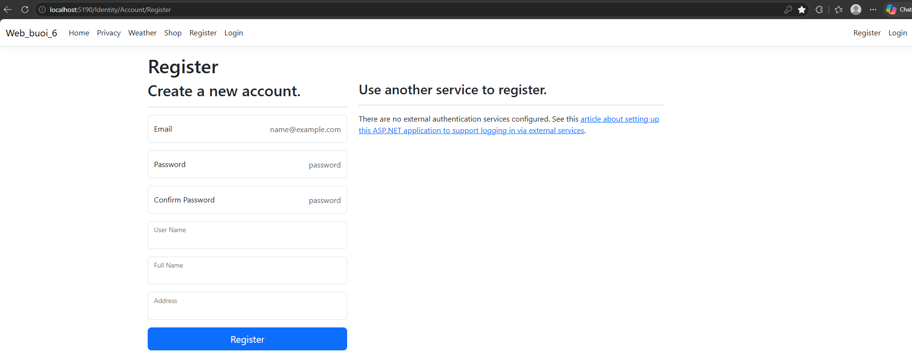

# Buổi 8 (12/06): Hoàn Thiện Kiến Trúc & Kiểm Thử Ứng Dụng Web

* **Học phần:** Lập trình Web (ASP.NET Core MVC)
* **Sinh viên:** Trần Tăng Trường Thịnh - 2387701939

---

## 📌 Chức Năng Chính
1. **Kiểm thử tích hợp hệ thống:** Tối ưu hóa pipeline Middleware, xử lý ngoại lệ toàn cục (`ExceptionHandler`).
2. **Bảo mật Controller & Action:** Áp dụng `[Authorize]`, `[ValidateAntiForgeryToken]`, bảo vệ dữ liệu form.
3. **Tối ưu hóa UI/UX:** Tích hợp giao diện hoàn thiện với Bootstrap 5 responsive.

---

## 🖼️ Hình Ảnh Giao Diện Hệ Thống

*Giao diện trang chủ ứng dụng web ASP.NET Core MVC hoàn thiện*

*Giao diện quản lý danh mục và danh sách dữ liệu trong hệ thống*