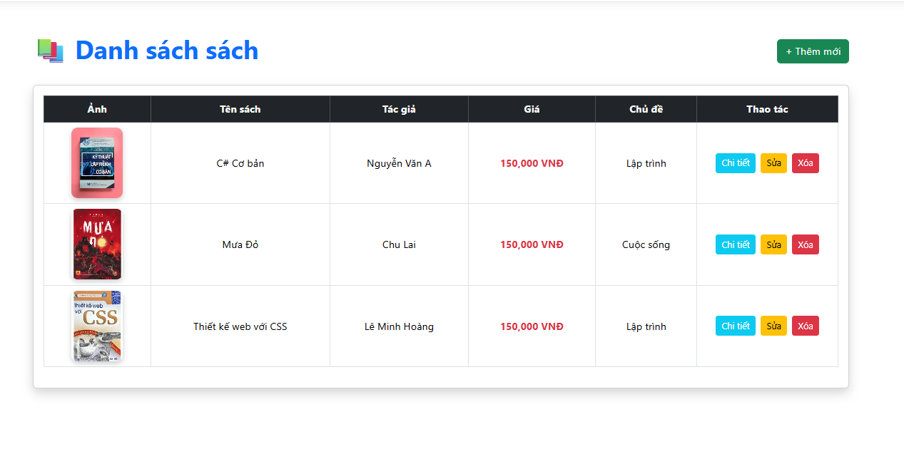
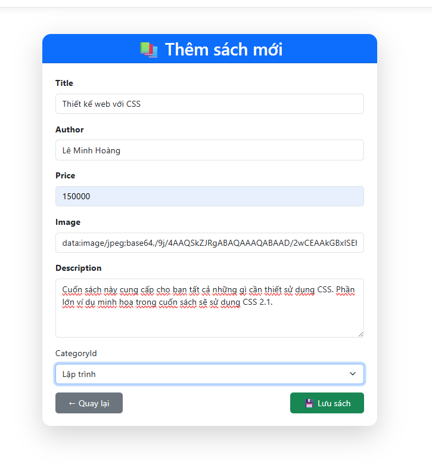

# Buổi 5 (22/05): Entity Framework Core & Kết Nối Cơ Sở Dữ Liệu SQL Server

* **Học phần:** Lập trình Web (ASP.NET Core MVC)
* **Sinh viên:** Trần Tăng Trường Thịnh - 2387701939

---

## 📌 Chức Năng Chính
1. **Code-First Migration:** Thiết lập `DbContext`, khai báo DbSet và tạo bảng tự động bằng lệnh `dotnet ef migrations add`.
2. **Quan hệ bảng (1 - Nhiều):** Thiết lập khóa ngoại giữa danh mục `Category` và sản phẩm `Product`.
3. **Thao tác dữ liệu bất đồng bộ:** Áp dụng `async/await` cho các truy vấn Entity Framework Core.

---

## 🖼️ Hình Ảnh Giao Diện Thực Hành

*Danh sách sản phẩm được đọc trực tiếp từ SQL Server qua Entity Framework Core*

*Form cập nhật thông tin sản phẩm và liên kết khóa ngoại danh mục*