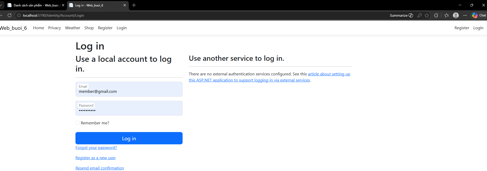

# Buổi 6 (29/05): Phân Hệ Quản Trị (Admin Area) & Xác Thực Người Dùng

* **Học phần:** Lập trình Web (ASP.NET Core MVC)
* **Sinh viên:** Trần Tăng Trường Thịnh - 2387701939

---

## 📌 Chức Năng Chính
1. **Cấu trúc Area Admin:** Tách biệt luồng người dùng thông thường và quản trị viên (`Areas/Admin`).
2. **ASP.NET Core Identity:** Đăng ký tài khoản, đăng nhập, bảo vệ session, mã hóa mật khẩu.
3. **Quản lý phân quyền Role-based:** Phân quyền vai trò `Admin` và `Customer`, kiểm soát quyền truy cập trang quản trị.

---

## 🖼️ Hình Ảnh Giao Diện Thực Hành

*Giao diện đăng nhập tài khoản người dùng tích hợp ASP.NET Core Identity*

*Khu vực quản trị danh mục sản phẩm dành riêng cho tài khoản có quyền Admin*