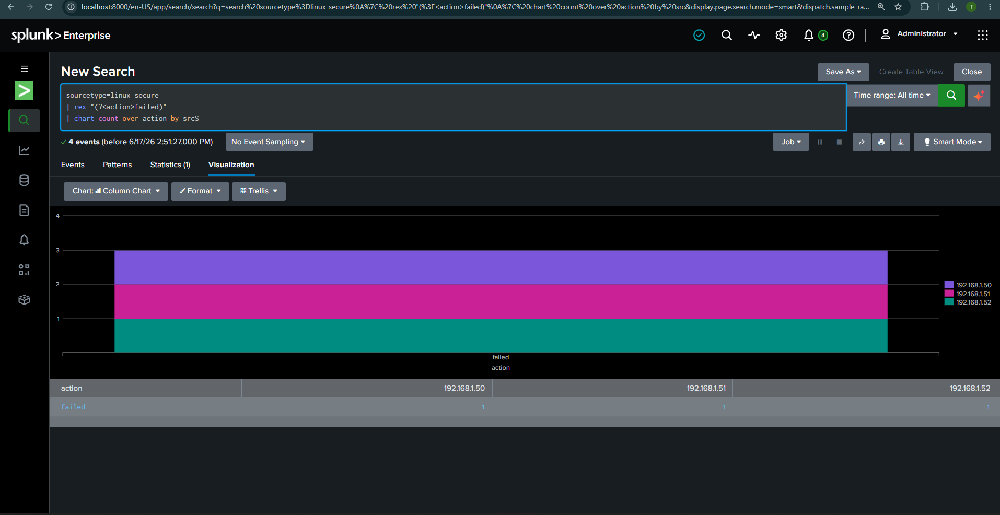
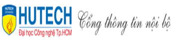

# 🎓 TỔNG HỢP CÁC BÀI THỰC HÀNH & ĐỒ ÁN - HUTECH

Kho lưu trữ toàn diện mã nguồn, tài liệu hướng dẫn, đề tài đồ án và báo cáo thực hành các môn học chuyên ngành **An toàn Thông tin / Công nghệ Thông tin** tại **Trường Đại học Công nghệ TP.HCM (HUTECH)**.

---

## 👨‍🎓 Thông tin sinh viên
* **Họ và tên:** Trần Tăng Trường Thịnh
* **MSSV:** 2387701939
* **Lớp:** 23DATA1
* **Khoa:** Công nghệ Thông tin
* **Chuyên ngành:** An toàn Thông tin

---

## 📂 Danh Mục Học Phần & Cấu Trúc Repository

`	ext
Thuc-Hanh-Hutech/
│
├── 📁 ATW&CSDL/                    # Môn An Toàn Web & Cơ Sở Dữ Liệu
│   ├── 📁 Bai 1/                   # Phân tích giao tiếp HTTP & Kiến trúc Web 3 lớp (3-tier)
│   ├── 📁 Bai 2/                   # Bảo mật Session, Cookie an toàn & Form Đăng nhập
│   ├── 📁 Bai 9/                   # Khai thác & Phòng thủ lỗ hổng OWASP Top 10 (SQLi, XSS, IDOR)
│   ├── 📁 Cuoi Ki/                 # Báo cáo & Slide thuyết trình đồ án đánh giá an ninh CSDL cuối kỳ
│   └── 📁 DoAnANW/                 # Đề tài nhóm: Hệ thống E-commerce tích hợp phát hiện gian lận (Fraud Detection)
│
├── 📁 DoAnVM_1112/                 # Tổng hợp Đồ án Chuyên ngành, Đồ án Cơ sở & Đồ án Linux
│   ├── 📁 DoAnChuyenNganh/         # Đề cương: Tích hợp AI vào SIEM phát hiện đe dọa từ EDR
│   ├── 📁 DoAnCoSo/                # Đề tài Nhóm 8: Bảo mật mạng doanh nghiệp với pfSense Firewall
│   └── 📁 DoanLinux/               # Đề tài: Giám sát mạng bằng Cacti & SNMP trên Linux
│
├── 📁 Lap_Trinh Web/               # Học phần Lập trình Web (ASP.NET Core MVC & Cloud Deployment)
│   ├── 📁 Web_buoi2_20_4           # Buổi 2: Thiết kế giao diện Web Responsive với HTML5 & CSS3
│   ├── 📁 Web_Buoi3__8_5           # Buổi 3: Làm quen kiến trúc MVC, Controller & ViewModel
│   ├── 📁 Web_Buoi4_15_5           # Buổi 4: Ứng dụng Quản lý công việc (Task Management CRUD)
│   ├── 📁 Web_buoi5_22_5           # Buổi 5: Entity Framework Core Code-First & Kết nối SQL Server
│   ├── 📁 Web_buoi6_29_5           # Buổi 6: Phân hệ Admin Area, Identity & Phân quyền Role-based
│   ├── 📁 Web_buoi7_5_6_Giua_Ky    # Bài thi giữa kỳ: Tích hợp API dự báo thời tiết & Quản lý User
│   ├── 📁 Web_Buoi_8_12_6          # Buổi 8: Hoàn thiện kiến trúc Middleware, Exception & UI
│   └── 📁 Thuyet_Trinh/            # Chuyên đề thuyết trình: Hướng dẫn Deploy dự án ASP.NET Core lên Railway
│
├── 📁 LTANTT/                      # Lập trình An toàn Thông tin (Python & Network Security)
│   ├── 📁 lab1/                    # Lab 1: Nhập môn Python, xử lý chuỗi & Mã hóa cổ điển (Caesar, Vigenère)
│   ├── 📁 lab2/                    # Lab 2: Socket TCP Client-Server, Port Scanner & Băm mật mã (MD5, SHA-256)
│   ├── 📁 lab 3/                   # Lab 3: Mô hình hóa đe dọa, Kali Linux, Nmap & Khai thác SMB MS17-010
│   └── 📁 lab5/                    # Lab 5: Tấn công & Phòng thủ lỗ hổng Web nâng cao (Burp Suite, SQLi, XSS, IDOR)
│
├── 📁 TH_AnToanWeb&CSDL/           # Thực hành An toàn Web & Cơ sở dữ liệu
│   ├── 📄 BÀI 1.pdf                # Lab 1: WebGoat và bắt gói tin với Burp Suite Proxy
│   ├── 📄 Bài 2.pdf                # Lab 2: Bảo mật Session, HTTPS/TLS và reCAPTCHA
│   ├── 📄 Lab3.pdf                 # Lab 3: Khai thác & Phòng chống Command Injection và SQL Injection
│   ├── 📄 Lab4.pdf                 # Lab 4: Khai thác lỗ hổng PHP (File Upload, LFI) và XSS
│   ├── 📄 Lab5.pdf                 # Lab 5: Khai thác lỗ hổng CSRF & Replay Request
│   └── 📁 Lab 6 26_10_26/          # Lab 6: Tường lửa Linux IPTables, Iptstate & Tự động hóa HTTP với Python
│
├── 📁 TH_Chieu_T4/                 # Thực hành An toàn Mạng & SOC (Splunk & Hybrid IPS)
│   ├── 📁 Buoi_1_13_5/             # Buổi 1: Hệ thống Hybrid IPS thời gian thực bằng Python + Tshark + IPTables
│   ├── 📁 Buoi_5_10_6/             # Buổi 5: Triển khai Splunk Enterprise SIEM, Universal Forwarder, Syslog & Alert
│   └── 📁 Buoi_6_16_6/             # Buổi 6: Thiết kế SOC Security Dashboard, Visualizations (SPL) & Drilldown
│
└── 📁 TH_Lap_Trinh_Web/            # Thực hành Lập trình Web (Source code trên lớp)
    ├── 📁 2387701939-TruongThinh-TH1-16_5  # TH1: Thiết kế giao diện Web Responsive với Bootstrap 5
    ├── 📁 2387701939-TranTangTruongThinh-TH2 # TH2: Mô hình MVC, Mock Repository & Tải tệp lên (File Upload)
    ├── 📁 2387701939-TruongThinh-TH4-6_6   # TH4: Kết nối SQL Server với EF Core Code-First Migrations & Admin Area
    ├── 📁 2387701939-TruongThinh-TH5-14_6  # TH5: Xây dựng Giỏ hàng (Shopping Cart) lưu trữ ISession & Checkout
    └── 📁 2387701939-TruongThinh-TH6-20_6  # TH6: Xây dựng dịch vụ RESTful Web API (CRUD JSON Endpoints)
`

---

## 🛠️ Công Nghệ & Nền Tảng Sử Dụng

| Lĩnh vực | Công cụ & Công nghệ |
| :--- | :--- |
| **Lập trình Web & Backend** | C# (.NET 8), ASP.NET Core MVC, Entity Framework Core, RESTful Web API, SQL Server LocalDB/Express |
| **Frontend & Giao diện** | HTML5, CSS3, JavaScript, Bootstrap 5, Font Awesome, Responsive Design |
| **An toàn Thông tin & SOC** | Splunk Enterprise SIEM, Splunk Universal Forwarder, SPL Query, Tshark (Wireshark CLI), Linux IPTables |
| **Kiểm thử Xâm nhập & Đánh giá**| Kali Linux, Nmap NSE, Metasploit Framework, Burp Suite Proxy, OWASP Top 10 |
| **Mạng & Tường lửa** | pfSense Firewall (WAN / LAN / DMZ, NAT, Rule filtering), VMware Workstation |
| **Giám sát Mạng** | Cacti Network Monitoring, SNMP Daemon (snmpd), RRDtool, MariaDB, Apache LAMP Stack |
| **Lập trình An toàn Mạng** | Python 3, Socket TCP/UDP, PyCryptodome, Hashlib, Requests |
| **Cloud & DevOps** | Railway Cloud Platform, Docker, Git, GitHub |

---

## 🖼️ Một Số Giao Diện Tiêu Biểu Trong Dự Án

### 1. Hệ thống SOC Dashboard Giám Sát An Ninh (Splunk SIEM)

### 2. Hệ thống E-commerce & Fraud Detection (Admin Dashboard)

### 3. Giám Sát Hiệu Năng & Lưu Lượng Mạng (Cacti SNMP)

---

## 📌 Hướng Dẫn Clone & Khởi Chạy
Để tải toàn bộ tài liệu và mã nguồn về máy cục bộ:
`ash
git clone https://github.com/TranThinh112/Thuc-Hanh-Hutech.git
cd Thuc-Hanh-Hutech
`

---
*© 2026 Trần Tăng Trường Thịnh - HUTECH. Mọi tài liệu và mã nguồn phục vụ mục đích học tập và nghiên cứu khoa học.*