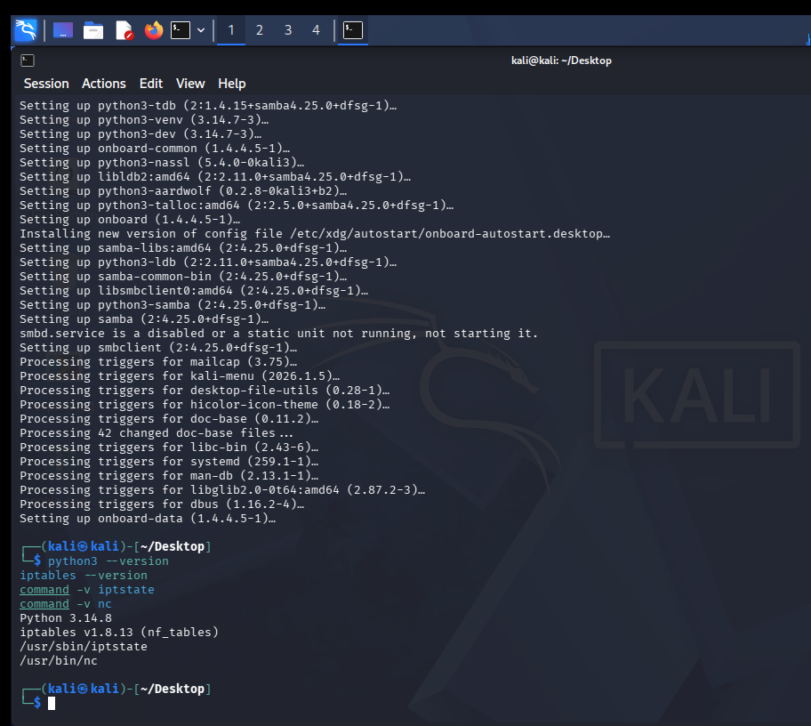
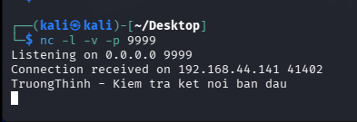

# Lab 6: Thiết Lập Tường Lửa IPTables & Tự Động Hóa HTTP Bằng Python

* **Học phần:** Thực hành An toàn Web & Cơ sở dữ liệu
* **Sinh viên:** Trần Tăng Trường Thịnh - 2387701939

---

## 📌 Chức Năng Chính
1. **Cấu hình Linux IPTables:**
   * Thiết lập Default Policy (`DROP`) cho chuỗi INPUT.
   * Mở cổng dịch vụ chọn lọc: SSH (22), HTTP (80), HTTPS (443).
   * Chống tấn công từ chối dịch vụ DoS/DDoS qua giới hạn tần suất kết nối (`limit` module).
2. **Giám sát trạng thái với Iptstate:** Theo dõi luồng kết nối TCP/UDP theo thời gian thực trên giao diện dòng lệnh.
3. **Tự động hóa HTTP với Python Requests:** Xây dựng script kiểm tra tình trạng dịch vụ (Health Check), trích xuất headers và gửi payload tự động.

---

## 🖼️ Hình Ảnh Kết Quả Thực Hành

*Danh sách các rules tường lửa IPTables bảo vệ máy chủ Linux*

*Giao diện Iptstate hiển thị chi tiết các luồng kết nối mạng đang hoạt động*