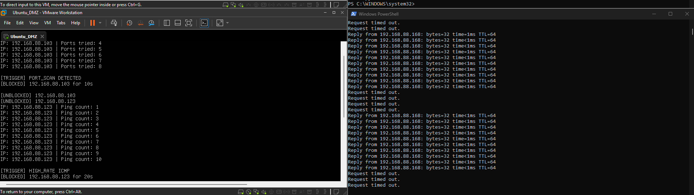
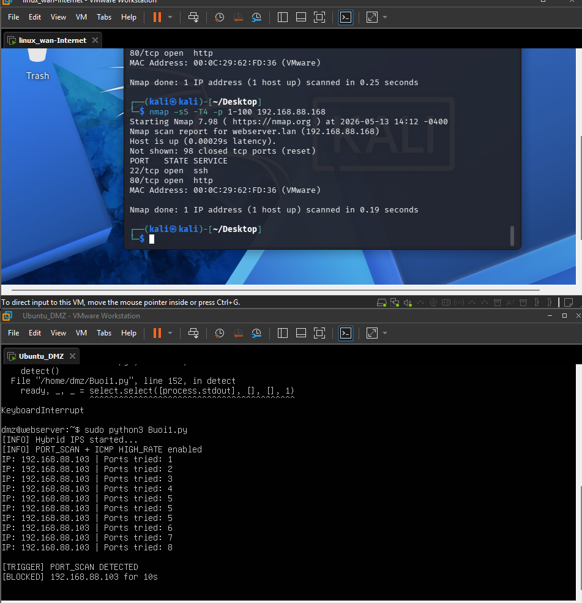

# Buổi 1 (13/05): Hệ Thống Giám Sát Mạng & Ngăn Ngừa Xâm Nhập Hybrid IPS

* **Học phần:** Thực hành An toàn Mạng & SOC (TH Chiều Thứ 4)
* **Sinh viên:** Trần Tăng Trường Thịnh - 2387701939

---

## 📌 Chức Năng Chính
1. **Bắt gói tin thời gian thực:** Tích hợp `Tshark` (Wireshark CLI) kết hợp script Python để giám sát lưu lượng đi qua card mạng.
2. **Phát hiện dấu hiệu tấn công:** Nhận diện hành vi Port Scanning (SYN Flood, FIN/NULL/XMAS Scan) hoặc ping sweep.
3. **Phản ứng tự động (IPS Engine):** Khi phát hiện IP có hành vi độc hại, script tự động chèn rule chặn vào `IPTables` để cô lập nguồn tấn công ngay lập tức.

---

## 🖼️ Hình Ảnh Thực Nghiệm

*Quá trình script Python bắt gói tin và phân tích luồng traffic mạng qua Tshark*

*Rule tường lửa tự động được thêm vào IPTables để chặn IP vi phạm*