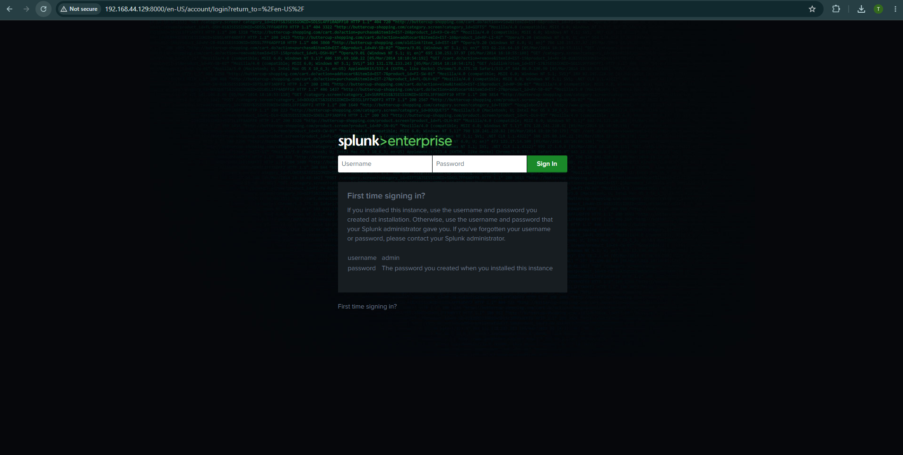
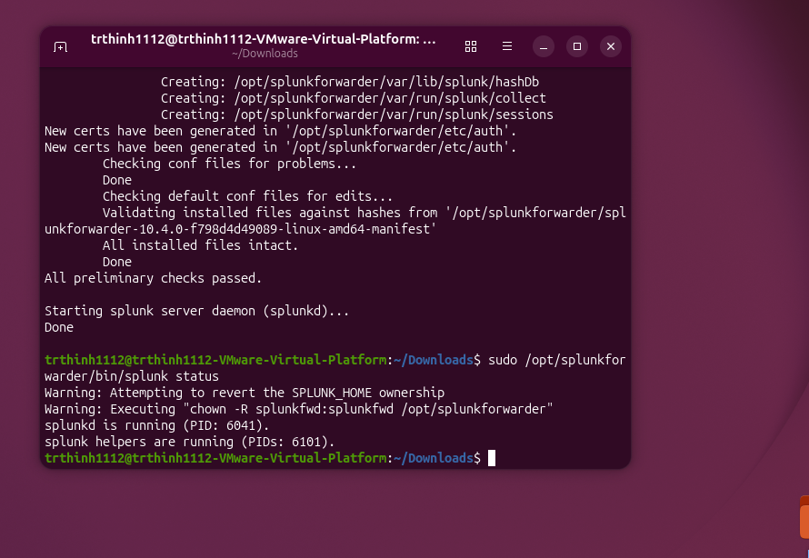

# Buổi 5 (10/06): Triển Khai Splunk Enterprise SIEM & Universal Forwarder

* **Học phần:** Thực hành An toàn Mạng & SOC
* **Sinh viên:** Trần Tăng Trường Thịnh - 2387701939

---

## 📌 Chức Năng Chính
1. **Triển khai kiến trúc SIEM Splunk:** Cài đặt Splunk Enterprise Server và cấu hình nhận log tập trung từ các nguồn.
2. **Cấu hình Splunk Universal Forwarder:** Thu thập log hệ thống (Syslog, Auth.log, Apache Access/Error log) và đẩy về Indexer qua cổng TCP 9997.
3. **Giám sát tính toàn vẹn tệp (FIM):** Theo dõi thay đổi các tệp nhạy cảm (`/etc/passwd`, `/etc/shadow`) và thiết lập Alert gửi thông báo tự động.

---

## 🖼️ Hình Ảnh Giao Diện Splunk

*Giao diện tìm kiếm dữ liệu log tập trung trên Splunk Enterprise*

*Trạng thái kết nối nhận log từ Splunk Universal Forwarder*