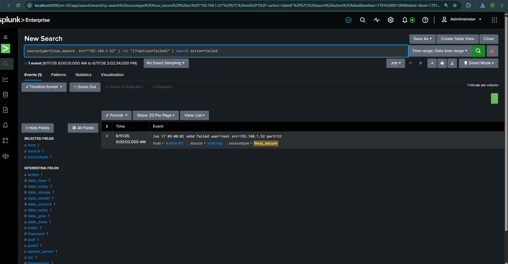

# Buổi 6 (16/06): Xây Dựng SOC Dashboard & Trực Quan Hóa Với SPL

* **Học phần:** Thực hành An toàn Mạng & SOC
* **Sinh viên:** Trần Tăng Trường Thịnh - 2387701939

---

## 📌 Chức Năng Chính
1. **Truy vấn phân tích bảo mật bằng SPL:** Sử dụng các lệnh `stats`, `chart`, `timechart`, `eval`, `rex` để trích xuất chỉ số an ninh từ log dữ liệu.
2. **Thiết kế SOC Dashboard chuyên nghiệp:**
   * Thống kê số lượng đăng nhập thất bại / thành công (Brute-Force Detection).
   * Phân bố vị trí địa lý nguồn tấn công (Top IP Attackers).
   * Biểu đồ Pie Chart, Column Chart trực quan theo thời gian thực.
3. **Interactive Drilldown:** Cho phép người dùng nhấp vào biểu đồ để xem chi tiết log gốc tương ứng.

---

## 🖼️ Hình Ảnh SOC Dashboard

*Giao diện SOC Dashboard tổng quan hiển thị các biểu đồ an ninh mạng trực quan*

*Biểu đồ phân tích lưu lượng và cảnh báo bất thường sử dụng Splunk SPL*